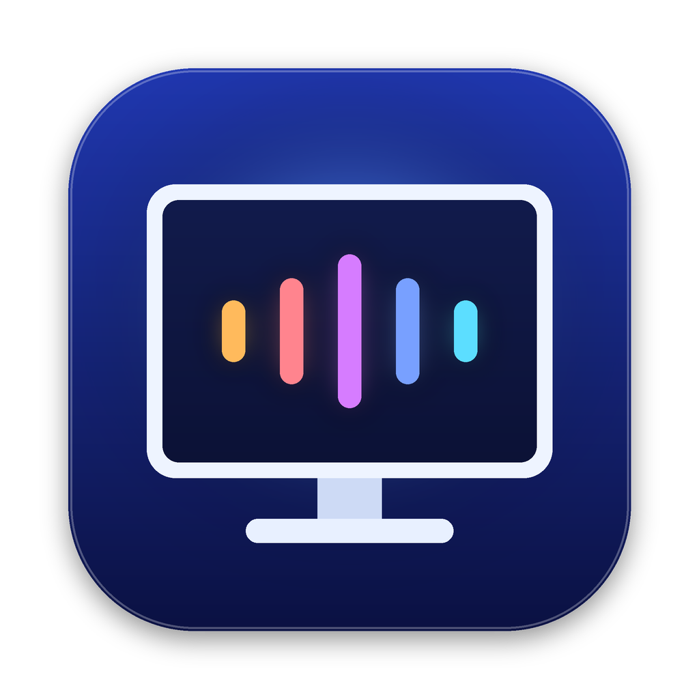
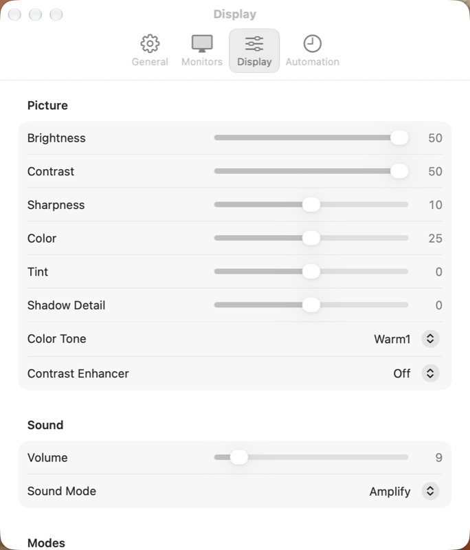

# Samsung Display Mate

Control the real brightness and volume of a Samsung smart monitor from your Mac, using your normal keyboard keys.

Samsung's Tizen monitors often don't respond to DDC, the standard way Mac apps control external displays. This menu bar app talks to the monitor over your local network instead. It starts working when the monitor is plugged in and steps aside when it's unplugged, so there's nothing to switch on and off.

Traffic stays on your local network. The app has no accounts, no cloud service and no analytics.



## Features

- **Keyboard control:** brightness, volume and mute keys adjust the monitor directly. Brightness moves in steps of about 1/16 like macOS, and volume uses finer steps at low levels. Hold Shift and Option for single steps.
- **Native-looking level banner:** a glass capsule with 16 segments appears in the top corner, matching the one in macOS 26 and later. Drag it for continuous adjustment.
- **Touch Bar:** the brightness control works, and a Control Strip button opens brightness and volume sliders for the monitor.
- **Automatic plug and unplug:** the app only takes over keys while the monitor is connected.
- **Sensible key routing:** volume keys apply when the monitor is your sound output, and brightness keys apply when the pointer is on its screen. Otherwise your Mac behaves normally.
- **Menu bar panel:** brightness and volume sliders, quick toggles and presets.
- **Presets:** Day, Night and Movie, each of which can be set from your current settings.
- **Schedule:** change preset at set times of day.
- **Automation:** switch to the Mac's input when plugged in, and optionally power the monitor off and on with your Mac.
- **Advanced picture and sound settings:** contrast, sharpness, color, tint, shadow detail, color tone, sound mode, game mode and more.
- **Shortcuts and Control Center:** actions for brightness, volume, mute, game mode and presets.

## Requirements

- An Apple silicon Mac running macOS 27 or later
- A Samsung Tizen smart monitor on the same local network as your Mac
- **IP Remote** turned on, on the monitor

### Tested hardware

Only the **Odyssey OLED G8 (G80SD, 2024)** has been tested, over DisplayPort. Other Samsung smart monitors may work, since community reports show the same protocol on the M7 and Odyssey OLED G9, but they're untested with this app. If you try one, please open an issue saying how it went.

## Install

1. Download the zip from [Releases](https://github.com/EthanPany/samsung-display-mate/releases/latest), unzip it, and move the app to Applications.
2. Open the app. It isn't notarized, so macOS will block it the first time. Go to **System Settings → Privacy & Security** and choose **Open Anyway**.
3. On the monitor, turn on **IP Remote**: Settings → All Settings → Connection → Network → Expert Settings. Labels vary by firmware.
4. In the app's **Monitors** tab, click **Pair**, then select **Allow** on the monitor. Allow Local Network access if your Mac asks.
5. In the **General** tab, click **Allow…** to give it Accessibility access, which it needs to use your keyboard keys. You can also turn on **Open at login** here.

Accessibility access is only used to catch media keys. Sliders and presets work without it.

## Known limitations

- **Early release, one test monitor.** See the status table below.
- **The protocol is undocumented.** Samsung doesn't publish it for general use, so a firmware update could change or break it.
- **One pairing per monitor (reported).** Pairing another app the same way may sign this one out. Use **Pair Again** if that happens.
- **Other display utilities can conflict.** BetterDisplay, MonitorControl and similar apps may compete for the same keys, so quit them or turn off their key handling.
- **Updating resets Accessibility.** Releases aren't signed with a stable developer identity, so after an update you may need to remove the app from the Accessibility list and add it again. Building it yourself with your own Apple developer team avoids this.
- **Picture mode is read-only.** The test monitor refused picture mode changes in HDR, so the app only displays the current mode.
- **The macOS volume slider and Apple's Touch Bar volume control stay greyed out.** macOS sees no volume control on DisplayPort audio. Use your keys, the app's panel, or its Touch Bar button instead.
- **The level banner is drawn by this app.** The real macOS banner requires an entitlement that only Apple can grant (`com.apple.private.system-banner-client`), so the app draws a close match. It doesn't highlight the menu bar icon as the real one does, and an OS update may change how closely they match.
- **The Touch Bar button uses private macOS APIs.** If a future macOS removes them, the button won't appear, and the rest of the app is unaffected.

## What's been tested

| Feature | Status |
|---|---|
| Brightness and volume, by keys and sliders | Confirmed on the test monitor |
| Level banner | Confirmed |
| Touch Bar brightness control and Control Strip sliders | Confirmed |
| Automatic plug and unplug | Confirmed |
| Bonjour discovery and pairing | Confirmed |
| Other settings (contrast, color tone, game mode and so on) | The monitor accepts and reports the change, not all checked by eye |
| Control Center buttons | The app responds to the signal they send; not yet tried from Control Center itself |
| Shortcuts actions | Registered with macOS; not yet run from a shortcut |
| Schedule | Time logic is unit-tested; not yet watched through a real change |
| Switching to another input | Only tested by re-selecting the current input |
| **Power off and on with the Mac** | **Untested on real hardware. Off by default. Keep your remote handy the first time you try it.** |

## How it works

The app uses Samsung IP Control, a JSON-RPC service over HTTPS on port 1516 of the monitor.

- **Detection:** display change callbacks spot the monitor by its vendor and model IDs, and Bonjour (`_samsungmsf._tcp`) finds its network address, even if that changes.
- **Sending:** commands go one at a time because the monitor resets overlapping connections, and only the newest slider value is sent.
- **Security:** the pairing token is kept in your Keychain, and the monitor's self-signed certificate is pinned at pairing. Anyone on your network who can answer the Allow prompt on the monitor could also pair, so use this on a network you trust, and don't expose the monitor's ports to the internet.

## Build from source

You'll need Xcode 27 and [XcodeGen](https://github.com/yonaskolb/XcodeGen).

```sh
brew install xcodegen
xcodegen generate
open SamsungDisplayMate.xcodeproj
```

Choose your own team under Signing & Capabilities for each target before running.

```sh
# Unit tests
xcodebuild test -project SamsungDisplayMate.xcodeproj -scheme SamsungDisplayMate -destination 'platform=macOS'

# Checks against a real monitor, using a token from pairing
SDM_HOST=<monitor ip> SDM_TOKEN=<token> scripts/live-check.sh

# Release zip
scripts/build-release.sh 1.0.0
```

## Credits

Protocol details come from community work, especially [ha-samsungtv-smart](https://github.com/TheFab21/ha-samsungtv-smart) and its protocol reference, [ha-samsungtv-brightness](https://github.com/proandreyyy/ha-samsungtv-brightness), [samsung-ip-brightness](https://github.com/CottTheWizard/samsung-ip-brightness), and [this BetterDisplay thread](https://github.com/waydabber/BetterDisplay/issues/5861).

## License

[MIT](LICENSE). This project isn't affiliated with or endorsed by Samsung. Samsung and Odyssey are trademarks of Samsung Electronics.
